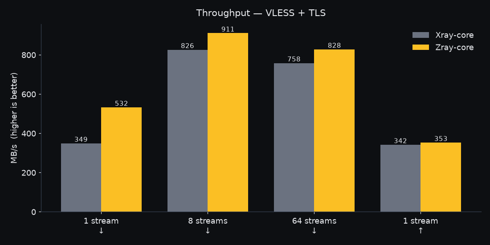
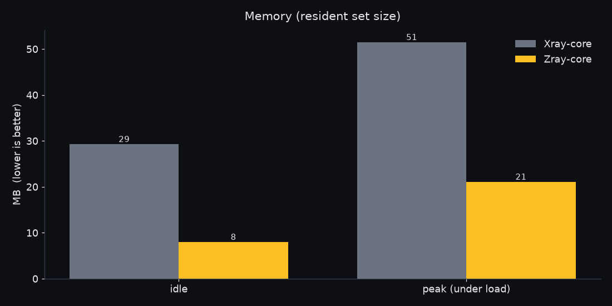
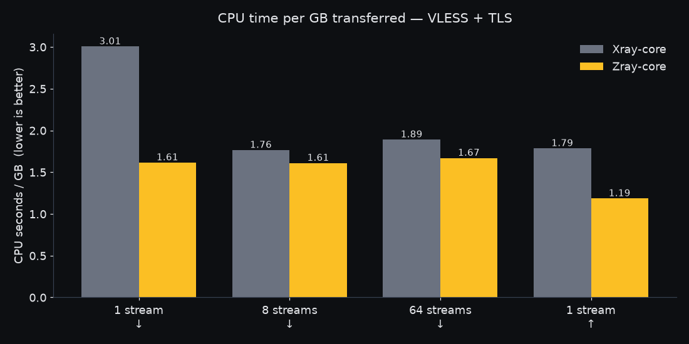
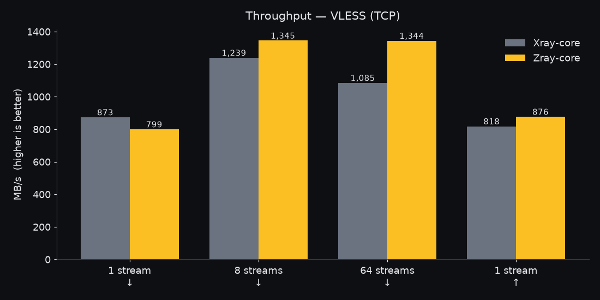

<div align="center">

# Zray Core

### The network core behind ZeroNet, written in Rust.
### هسته‌ی شبکه‌ی زیرونت، نوشته‌شده با Rust.

[فارسی](#فارسی) · [English](#english)

</div>

---

<div dir="rtl">

## فارسی

**Zray Core** هسته‌ی شبکه‌ی ZeroNet است، از صفر با **Rust** نوشته شده و با کانفیگ‌های Xray سازگار است (VLESS،&rlm; REALITY،&rlm; Vision،&rlm; XHTTP،&rlm; VMess،&rlm; Trojan،&rlm; Shadowsocks و…). اپ‌ها روی این هسته ساخته می‌شوند و هرکدام ریپوی خودشان را دارند:

| ریپو | چیست؟ |
|---|---|
| [ZeroNet-Desktop](https://github.com/ZeroNetTeam/ZeroNet-Desktop) | برنامه‌ی ترمینالی برای ویندوز و لینوکس |
| [ZeroNet-Mobile](https://github.com/ZeroNetTeam/ZeroNet-Mobile) | برنامه‌ی اندروید |
| [Z-UI](https://github.com/ZeroNetTeam/Z-UI) | برنامه‌ی گرافیکی (در دست ساخت) |

### ⚡ چرا این‌قدر سریع است؟

زبان Rust به کد ماشین کامپایل می‌شود و Garbage Collector ندارد. پس برنامه هیچ‌وقت برای «جمع‌کردن حافظه» مکث نمی‌کند و فقط همان حافظه‌ای را می‌گیرد که واقعاً لازم دارد. نتیجه: اینترنت سریع‌تر، مصرف کمتر رم و CPU، و باتری ماندگارتر، حتی روی سیستم‌ها و گوشی‌های ضعیف.

ما Zray و Xray-core را روی یک سیستم، با یک سرور و یک کانفیگ مقایسه کردیم. تنها چیزی که عوض شد هسته‌ی کلاینت بود:

| | Xray-core | **Zray** |
|---|---:|---:|
| سرعت دانلود با TLS (یک اتصال) | ۳۴۹ مگابایت بر ثانیه | **۵۳۲ مگابایت بر ثانیه** (۵۳٪ سریع‌تر) |
| مصرف CPU برای هر گیگابایت (TLS) | ۳٫۰ ثانیه | **۱٫۶ ثانیه** (۴۶٪ کمتر) |
| رم در حالت بیکار | ۲۹ مگابایت | **۸ مگابایت** (۳٫۷ برابر کمتر) |
| بیشترین مصرف رم زیر بار | ۵۱ مگابایت | **۲۱ مگابایت** (۲٫۴ برابر کمتر) |

</div>

<p align="center">
  
  
  
  
</p>

<div dir="rtl">

در همه‌ی تست‌ها، Zray مصرف CPU کمتری داشت. تنها موردی که Xray جلو بود، دانلود تک‌اتصالی بدون TLS بود (۸۷۳ در برابر ۷۹۹ مگابایت بر ثانیه). همه‌ی نتایج را همان‌طور که اندازه گرفته شد گذاشته‌ایم. روش تست و ابزار تکرار آن در [docs/benchmarks](docs/benchmarks) است.

### 📥 نصب

برنامه‌ی خط فرمان **zray** در صفحه‌ی **[Releases](https://github.com/ZeroNetTeam/Zray-Core/releases/latest)** است: `ZrayCore-Windows-x64.zip`،&rlm; `ZrayCore-Linux-x64.tar.gz` و `ZrayCore-Linux-ARM64.tar.gz`. فایل را باز کنید و `zray run config.json` را بزنید (`zray help` بقیه‌ی دستورها را نشان می‌دهد).

> مطمئن نیستید کدام فایل لینوکس؟ در ترمینال `uname -m` را بزنید: `x86_64` یعنی **x64** و `aarch64` یعنی **ARM64**.

### 🛠️ استفاده در پروژه‌ی خودتان

راهنما در [docs/embedding.md](docs/embedding.md) است.

</div>

---

## English

**Zray Core** is the network core behind ZeroNet. It is written from scratch in
**Rust** and speaks the same configs as Xray: VLESS, REALITY, Vision, XHTTP,
VMess, Trojan, Shadowsocks and more. The apps are built on top of it, and each
has its own repository:

| Repository | What it is |
|---|---|
| [ZeroNet-Desktop](https://github.com/ZeroNetTeam/ZeroNet-Desktop) | the terminal app for Windows and Linux |
| [ZeroNet-Mobile](https://github.com/ZeroNetTeam/ZeroNet-Mobile) | the Android app |
| [Z-UI](https://github.com/ZeroNetTeam/Z-UI) | the graphical app (in the works) |

### ⚡ Why it's fast

Rust compiles to native code and has no garbage collector. The core never
pauses to clean up memory and only holds the memory it actually uses. That
means more speed, less RAM and CPU, and longer battery life, even on old
laptops and cheap phones.

We ran Zray and Xray-core on the same machine, against the same server,
from the same config file. Only the client core changed:

| | Xray-core | **Zray** |
|---|---:|---:|
| Download over TLS, 1 connection | 349 MB/s | **532 MB/s** (+53%) |
| CPU time per GB over TLS | 3.0 s | **1.6 s** (−46%) |
| Memory at idle | 29 MB | **8 MB** (3.7× less) |
| Peak memory under load | 51 MB | **21 MB** (2.4× less) |

Zray used less CPU per gigabyte in every test. Xray was faster in one case:
a single plain-TCP download (873 vs 799 MB/s). We publish every number as
measured. The charts are above; the method and the harness to reproduce them
are in [docs/benchmarks](docs/benchmarks).

### 📥 Install

The **zray** command-line program is on the **[Releases page](https://github.com/ZeroNetTeam/Zray-Core/releases/latest)**
as `ZrayCore-Windows-x64.zip`, `ZrayCore-Linux-x64.tar.gz` and
`ZrayCore-Linux-ARM64.tar.gz`. Unpack it and run `zray run config.json`
(`zray help` lists the rest). It is meant for servers, routers and scripts.

Not sure which Linux file? Run `uname -m`: `x86_64` means **x64**, `aarch64`
means **ARM64**.

### 🛠️ Build from source

```sh
cargo build --release -p zray-cli   # target/release/zray
cargo test --workspace
```

### Use it in your own project

The crates are meant to be used as git dependencies, which is how the three
apps do it. [docs/embedding.md](docs/embedding.md) has the `Cargo.toml` to copy
and `tools/link-local.sh`, which builds an app against your local checkout of
this repository.

### Repository layout

| Path | What it is |
|---|---|
| `crates/` | The Rust workspace: protocols, transports, DNS, routing, evasion, discovery, TUN, the server installer, and the `zray` program (`zray-cli`). |
| `vendor/` | The patched `rustls` and `netstack-smoltcp` the workspace builds with. Apps repeat this patch. |
| `docs/` | Benchmarks, protocol specs, platform notes, embedding guide. |
| `deploy/` | The inputs of the verified-servers list (feeds, Telegram channels, decoy names) and the optional edge relay. |
| `bench/`, `fuzz/` | Allocation and traffic-shape benchmarks, and fuzz targets for the parsers. |
| `tools/` | `link-local.sh`, for working on the core and an app together. |
| `.github/` | CI, the release build, and the workflows that publish the shared feeds on the `crowd-data` branch. |

### License

GPL-3.0 (see `LICENSE`). Third-party components keep their own licences.
